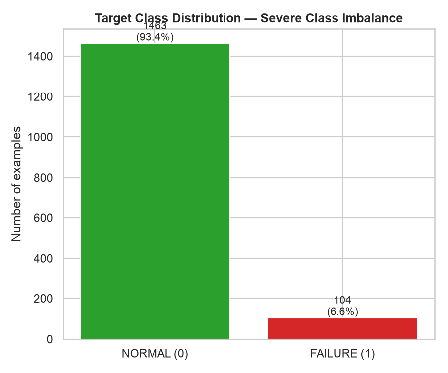
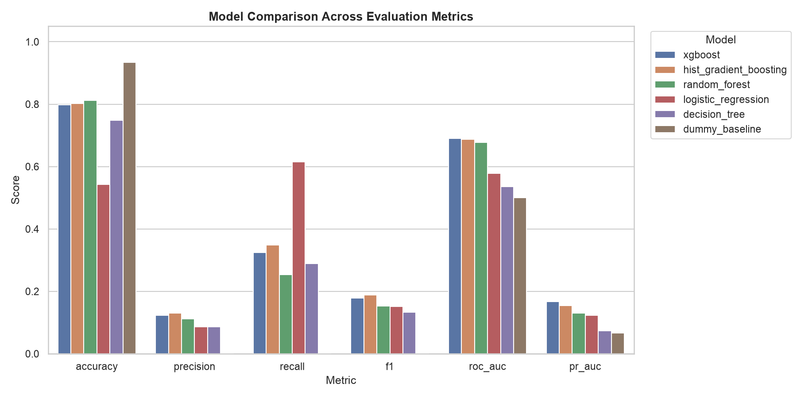
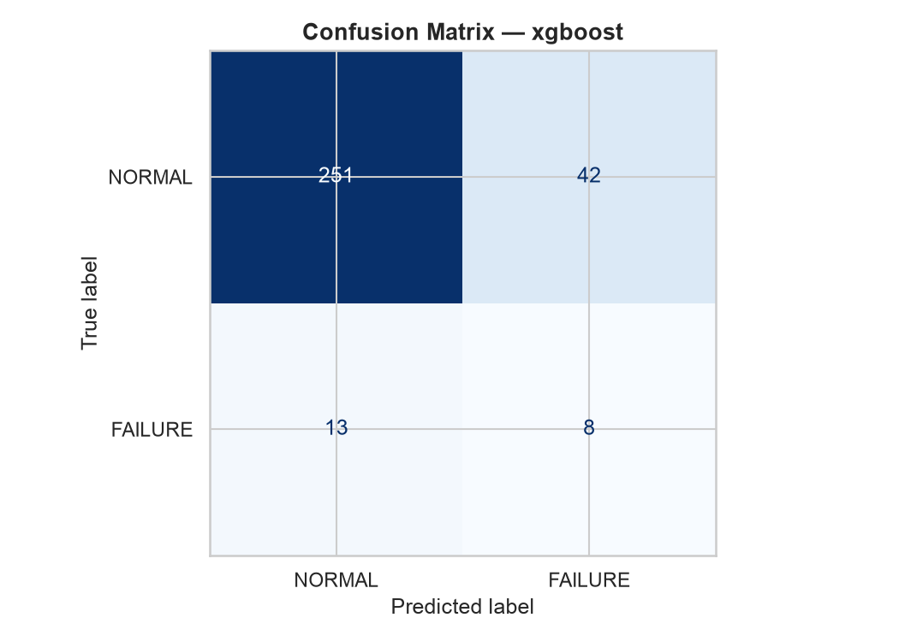
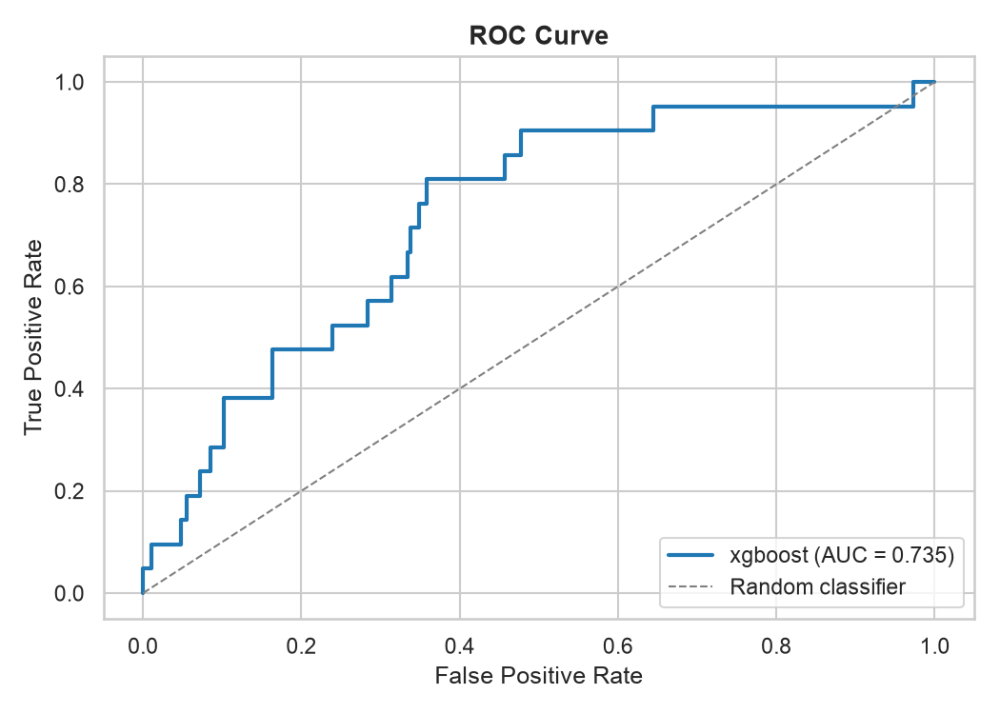
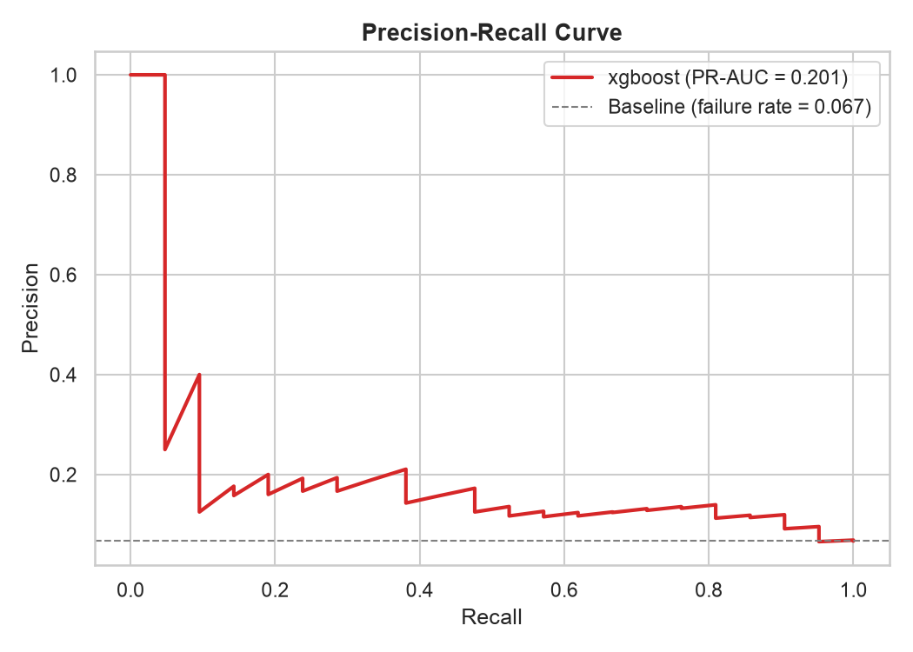
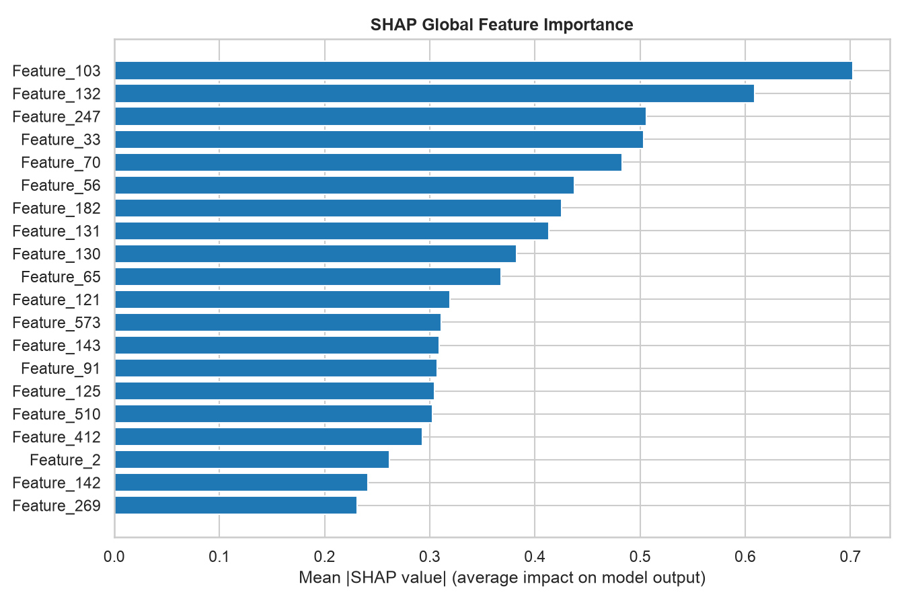

# Explainable AI for Predictive Maintenance

An end-to-end research project for predicting manufacturing failures from the SECOM semiconductor process dataset. It combines data diagnostics, leakage-aware preprocessing, model evaluation, failure-risk prediction, SHAP/LIME/DiCE explanations, explanation-quality experiments, and a 14-page Streamlit dashboard.

> **Project status:** research and demonstration software. It is not a plant control system. Model outputs, explanations, and counterfactuals do not establish physical causes or validated maintenance actions.

## Results at a glance

The repository includes the dataset, fitted model artifacts, experiment reports, and generated figures. You can open the dashboard without training the model again.

| Held-out test metric | Result |
|---|---:|
| Accuracy | 0.8248 |
| Precision | 0.1600 |
| Recall | 0.3810 |
| F1 | 0.2254 |
| ROC-AUC | 0.7348 |
| PR-AUC (average precision) | 0.2006 |

At the saved threshold of **0.47**, the model detected 8 of 21 failures and missed 13. The test set has already been inspected during project development; these are retrospective results from one split, not prospective validation. Accuracy alone is misleading for this imbalanced dataset.

## Screenshots and generated results

The figures below are generated from the included dataset and project runs. Click a chart to open the full-size image.

### Dashboard and model evaluation

| Class balance | Model comparison | Confusion matrix |
|---|---|---|
| [](outputs/figures/eda_class_distribution.png) | [](outputs/figures/model_comparison_baseline.png) | [](outputs/figures/confusion_matrix_xgboost.png) |

| ROC curve | Precision-recall curve | SHAP global importance |
|---|---|---|
| [](outputs/figures/roc_curve_xgboost.png) | [](outputs/figures/pr_curve_xgboost.png) | [](outputs/explanations/shap_global_importance.png) |

More plots and explanation examples are available in [`outputs/figures/`](outputs/figures/) and [`outputs/explanations/`](outputs/explanations/). Machine-readable metrics are in [`outputs/metrics/`](outputs/metrics/), including [`final_evaluation.json`](outputs/metrics/final_evaluation.json) and [`xai_evaluation.json`](outputs/metrics/xai_evaluation.json).

## Run the dashboard

### Requirements

- Python **3.12** (used for project verification)
- pip
- macOS, Linux, or Windows with a shell

### 1. Get the project and create an environment

From the repository root:

```bash
git clone <repository-url>
cd xai-predictive-maintenance
python3.12 -m venv .venv
```

Activate the environment:

```bash
# macOS / Linux
source .venv/bin/activate

# Windows PowerShell
.venv\Scripts\Activate.ps1
```

If your system's Python 3.12 command is named `python` or `python3`, use that command instead of `python3.12` when creating the environment.

### 2. Install dependencies

```bash
python -m pip install --upgrade pip
python -m pip install -r requirements.txt
```

### 3. Start Streamlit

Run this from the repository root:

```bash
python -m streamlit run app/app.py
```

Open **http://localhost:8501** in your browser. Stop the server with `Ctrl+C` in the terminal.

The included data and saved model artifacts mean no training is needed for the dashboard. The app contains Overview, Dataset, Prediction, SHAP Explanation, LIME Explanation, Counterfactual Analysis, Model Runs, Run Comparison, Model Benchmark, XAI Evaluation, Robustness, Explanation-Guided Analysis, Decision Support, and Technical Details pages.

## Reproduce or extend the analysis

Run these commands from the repository root with the virtual environment activated.

### Regenerate explanation and analysis reports

```bash
python run_experiments.py
```

The default run evaluates 30 randomly sampled test cases and refreshes explanation, feature-ablation, and synthetic distribution-shift results. Useful options:

```bash
python run_experiments.py --samples 100
python run_experiments.py --refresh-benchmark
python run_experiments.py --run <saved-run-id>
```

### Train the full pipeline

```bash
python train_pipeline.py
python run_experiments.py
```

The full tuning workflow takes longer than launching the dashboard. It can replace the main saved model artifacts, so retain a copy if you need the checked-in model unchanged.

### Train additional isolated model runs

```bash
python train_runs.py --models random_forest hist_gradient_boosting
python run_experiments.py --run <saved-run-id>
```

Additional runs are stored under `models/runs/` and do not replace the original model artifacts. The Model Runs page also supports training candidates from the UI.

### Run checks

```bash
python -m unittest discover -s tests -v
python tests/smoke_ui.py
python tests/smoke_model_switch.py
```

For the optional real-browser check, install development dependencies and start the app in another terminal first:

```bash
python -m pip install -r requirements-dev.txt
python tests/browser_smoke.py
```

## Project structure

```text
app/                  Streamlit app and page views
data/                 Included SECOM sensor and label files
models/               Saved estimator, preprocessing, metadata, and model runs
notebooks/            Exploratory analysis notebook
outputs/figures/      Generated EDA and evaluation charts
outputs/explanations/ SHAP, LIME, and DiCE example artifacts
outputs/metrics/      Evaluation reports and experiment metrics
src/                  Loading, preprocessing, training, prediction, XAI modules
tests/                System, model-run, UI, and browser checks
run_experiments.py    Explanation and analysis experiment runner
train_pipeline.py     Full model training and evaluation pipeline
train_runs.py         Train additional saved model runs
```

## Dataset and methodology

The included SECOM dataset has **1,567 manufacturing runs**, **590 anonymous sensor features**, and **104 failures**. Raw labels `-1` and `+1` are mapped to normal (`0`) and failure (`1`). The stratified seed-42 split has 1,253 training rows and 314 test rows. Timestamps are excluded from prediction features.

Preprocessing is fitted on training data: features with more than 55% missing values are removed, remaining missing values are median-imputed, constant columns are dropped, and values are standardized. Feature selection and resampling are performed within the model pipeline. The deployed XGBoost model uses 40 selected features and the saved decision threshold was selected from training-only out-of-fold predictions.

Current XAI evaluation means across 30 sampled test rows:

| Measure | Mean | Interpretation |
|---|---:|---|
| Faithfulness | 0.3004 | Excess absolute probability change for top-SHAP feature replacement over random replacements |
| LIME fidelity | 0.1442 | Distance-weighted fit on the neighborhood used to fit the local surrogate |
| SHAP stability | 0.9848 | SHAP cosine similarity under 1% training-standard-deviation noise |
| SHAP/LIME consistency | 0.4779 | Top-five Jaccard similarity |
| SHAP robustness | 0.8994 | SHAP cosine similarity under 10% training-standard-deviation noise |

These measures describe different properties and are not combined into a trust score. In particular, LIME fidelity is weak on average, and high SHAP stability does not establish model accuracy, causality, or operational reliability. See [`PROJECT_GUIDE.md`](PROJECT_GUIDE.md) for detailed protocols, experimental definitions, dashboard walkthrough, and limitations.

## Important limitations

- The data has no protected demographic attributes, so demographic fairness cannot be evaluated directly.
- There are only 21 failures in the held-out test split; the reported metrics are uncertain and split-specific.
- Model probabilities are not calibrated. Sensor names are anonymous and have unknown physical meaning and actionability.
- Perturbation experiments can create unrealistic sensor combinations. DiCE counterfactuals are model what-ifs, not recommended equipment adjustments.
- This project does not measure maintenance benefit, human usefulness, causality, or production reliability.

## License and attribution

No license file is currently included. Add a license and dataset attribution appropriate to your intended distribution before publishing or redistributing the repository.
